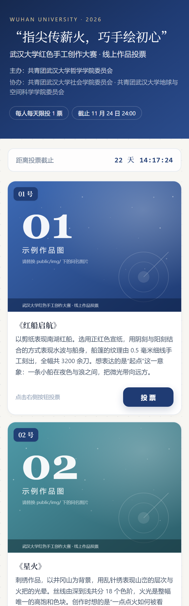
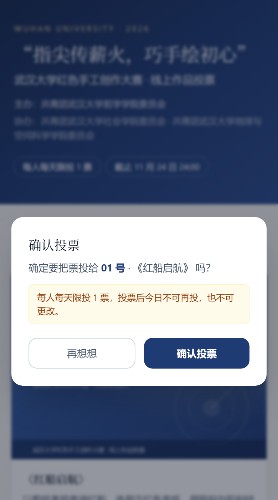
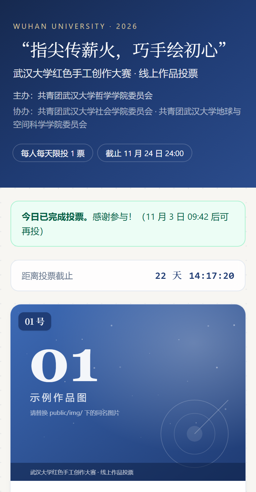
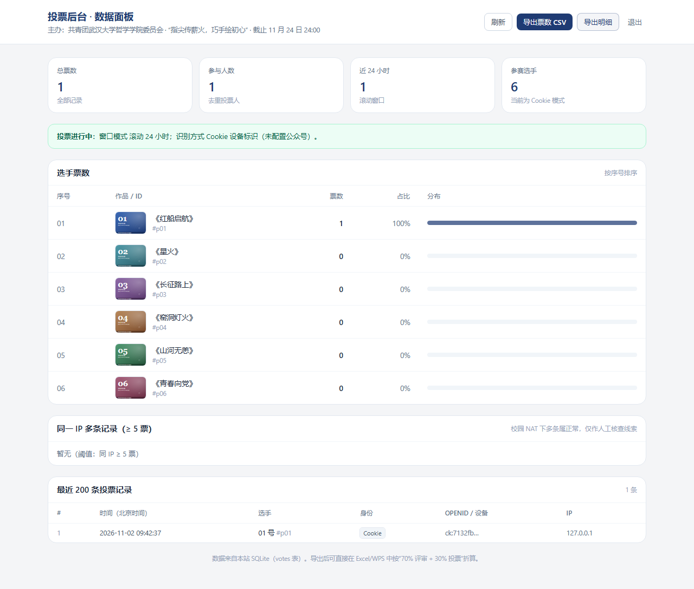

# 校园活动线上投票 H5

武汉大学“指尖传薪火，巧手绘初心”红色手工创作大赛的线上投票页（公众号：哲样青春）。**零第三方依赖**（Node 内置 `http` + `node:sqlite` + 内置 `fetch`），不使用 WPS 表单或任何第三方表单外链。

- 前端：原生 HTML + TailwindCSS（CDN）+ 原生 JS，移动端优先
- 后端：Node.js（≥ 22.5，推荐 24）+ SQLite（本地文件）
- 部署：Render 免费实例，`render.yaml` 一键蓝图

---

## 1. 功能对照

| 需求 | 实现 |
| --- | --- |
| 首页选手卡片：序号 / 图片 / 200 字阐述 / 投票按钮 | `public/index.html`，响应式 1/2/3 列；阐述超 5 行自动出现“展开全文” |
| 点击投票弹确认框 | 自制模态框，含“不可更改”提示 |
| 每人每天 1 票（对任意选手都算） | 按**北京自然日**判定（`bj_date` 字段），同一 Cookie 当天最多 1 票，次日 00:00 自动解锁 |
| 投票成功的提示 | Toast + 顶部状态条：<br>“投票成功！今日已完成投票，请明天再来”（**不显示剩余小时倒计时**） |
| 记录 IP 用于防刷 | `votes` 表记录 `ip`、`ua`、身份类型、`created_at`、`bj_time`（完整北京时间） |
| 后台面板（独立路由 + 密码） | `/admin`，密码来自 `ADMIN_PASSWORD`，8 小时会话 |
| 查看票数 / 导出 CSV | `/admin/data.json`、`/admin/export.csv`、`/admin/export.csv?type=votes` |
| 11 月 24 日 24:00 截止锁 | 服务端强制校验（改前端无效），前端倒计时并置灰 |
| 微信内打开优先用 openid | 配置 `WX_APPID`/`WX_SECRET` 后，微信内自动静默授权，openid 作为投票身份 |
| 不实现计分 | 只统计票数；70% 评审 + 30% 票的折算是后续 Excel 人工完成 |

### 界面预览

| 首页（手机 390px） | 确认弹窗 |
| --- | --- |
|  |  |

| 投票成功后（按钮全部置灰） | 截止后（仅展示） | 后台面板 |
| --- | --- | --- |
|  |  |  |

> 截图中的作品图是 `public/img/` 下的占位 SVG，换成真实照片即可；示例作品名与阐释同为占位内容。


---

## 2. 目录结构

```
campus-vote/
├── server.js                 # HTTP 服务 + 路由 + 投票/后台逻辑
├── src/
│   ├── config.js             # 全部配置（环境变量）
│   ├── db.js                 # SQLite 建表与查询
│   ├── security.js           # Cookie 签名、防篡改、密码恒时比较
│   ├── wechat.js             # 微信网页授权（snsapi_base）
│   └── csv.js                # CSV 导出（带 BOM）
├── public/
│   ├── index.html            # 投票首页（移动端优先）
│   ├── admin.html            # 后台面板
│   └── img/player-*.svg      # 示例作品图（换成真实图片即可）
├── data/
│   ├── players.json          # 选手名单（序号/姓名/图片/阐述）
│   └── votes.db              # SQLite 数据库（运行时生成）
├── docs/
│   ├── OPERATIONS.md         # ⭐ 操作手册：改内容 → 自检 → 收尾 → 折算（SOP）
│   └── preview-*.png         # 界面截图（README 里引用）
├── scripts/
│   ├── make-placeholders.js  # 生成示例图
│   ├── seed-demo.js          # 造演示数据（后台预览用）
│   └── smoke-test.js         # 冒烟测试（自起两个实例，覆盖 20+ 项）
├── deploy/                   # 学校/云服务器部署（可选）
│   ├── DEPLOY-SERVER.md      # 部署手册 + 权限申请清单
│   ├── REQUEST-TEMPLATE.md   # 给团委/信息中心/公众号管理员的申请模板
│   ├── nginx.conf.example    # Nginx 反代 + HTTPS 示例
│   ├── campus-vote.service   # systemd 守护配置
│   └── ecosystem.config.cjs  # pm2 配置
├── render.yaml               # Render 一键部署蓝图
├── .env.example              # 环境变量清单
└── README.md
```

---

## 3. 本地跑起来（3 步）

> 需要 Node ≥ 22.5（推荐 24，`node:sqlite` 免 flag）。检查：`node -v`

```bash
cd campus-vote
cp .env.example .env      # Windows: copy .env.example .env
npm start                 # 没有任何依赖，等于 node server.js
```

- 投票页：<http://localhost:8787>
- 后台：<http://localhost:8787/admin>（默认密码 `admin1234`，**上线前务必改**）

想看后台有数据的样子：

```bash
node scripts/seed-demo.js      # 造 120 条演示投票
# 想清空重来：删掉 data/votes.db 再启动，或 node scripts/seed-demo.js --force
```

跑一遍自动化检查（会自己起 8891/8892 两个临时实例，不影响正式数据）：

```bash
node scripts/smoke-test.js
```

---

## 4. 配置项（全部走环境变量）

| 变量 | 默认 | 说明 |
| --- | --- | --- |
| `PORT` | `8787` | 监听端口（Render 会自动注入） |
| `PUBLIC_BASE_URL` | `http://localhost:8787` | 对外地址，微信授权回调要用，必须是 https 正式域名 |
| `VOTE_DEADLINE` | 自动：最近的 11-24 23:59:59 (+08:00) | 截止时间，建议正式活动写死，如 `2026-11-24T23:59:59+08:00` |
| `VOTE_DEADLINE_LABEL` | `11 月 24 日 24:00` | 前端展示用的文字 |
| `VOTE_WINDOW_MODE` | `calendar` | `calendar`＝**北京时间自然日一天一票**（默认，00:00 重置）；`rolling`＝旧版滚动 24h（仅兼容保留） |
| `ADMIN_PASSWORD` | `admin1234` | 后台密码，务必修改 |
| `SESSION_SECRET` | 自动生成并存到 `data/.session-secret` | Cookie 签名密钥 |
| `DB_PATH` | `./data/votes.db` | SQLite 路径（挂载磁盘时改这里） |
| `PLAYERS_PATH` | `./data/players.json` | 选手名单 |
| `WX_APPID` / `WX_SECRET` | 空 | 都填才启用 openid 模式 |
| `IP_LIMIT_MAX` / `IP_LIMIT_WINDOW_MIN` | `80` / `10` | 单 IP 每 10 分钟最多票数（软限流，防脚本洪水） |
| `SHOW_COUNTS` | `false` | 公开页是否显示实时票数 |
| `EVENT_TITLE` / `EVENT_SUBTITLE` / `EVENT_ORG` / `EVENT_ORG2` | 见 `.env.example` | 活动标题、主办/协办文案 |

**投票限制规则（已改为自然日）**

- 现行规则：**北京时间自然日一天一票**（0:00–24:00 为一天，次日 0 点自动解锁）。
  判定依据是 `votes.bj_date`（`YYYY-MM-DD`，Asia/Shanghai），与服务器所在时区无关。
- 兼容开关：只有在环境变量里显式写 `VOTE_WINDOW_MODE=rolling` 才会回到旧的“滚动 24 小时”。
  **如果是从旧版本升级，请删掉 `.env` / Render 里的 `VOTE_WINDOW_MODE` 这一行**（不删的话仍是旧行为，启动日志会打印警告）。
- 取舍说明：自然日规则下，23:59 投一票、00:01 再投一票在规则上是允许的（跨了两个自然日）；
  这是“每天一票”的固有含义，配合 Cookie + IP 记录已足够，不必再用滚动窗口。

两者都实现好了，改一个环境变量即可切换。**默认就是 `calendar`（自然日），无需配置**。

---

## 5. 部署到 Render（免费档，分步）

> 另一种做法是部署到学校/云服务器（支持 openid、数据可持久），手册在
> **[deploy/DEPLOY-SERVER.md](deploy/DEPLOY-SERVER.md)**，配套的 Nginx / systemd / pm2 配置样例也在 `deploy/` 目录；
> 需要向学院、信息中心、公众号管理员申请什么，见 **[deploy/REQUEST-TEMPLATE.md](deploy/REQUEST-TEMPLATE.md)**（三封可直接改用的申请模板）。

### 5.1 推到 GitHub

```bash
cd campus-vote
git init && git add . && git commit -m "feat: campus vote h5"
git branch -M main
git remote add origin git@github.com:<你的账号>/campus-vote.git
git push -u origin main
```

> `data/votes.db`、`.env`、`data/.session-secret` 已被 `.gitignore` 排除，不会泄露。

### 5.2 在 Render 创建服务（二选一）

**A. 蓝图（推荐，省事）**

1. 登录 <https://dashboard.render.com>
2. 右上角 **New +** → **Blueprint**
3. 选择刚推送的仓库 → Render 自动读到 `render.yaml` → **Apply**
4. 蓝图里标了 `sync: false` 的两个变量（`ADMIN_PASSWORD`、`PUBLIC_BASE_URL`）会要求你填：
   - `ADMIN_PASSWORD`：强密码
   - `PUBLIC_BASE_URL`：先随便填，第 5.4 步拿到域名后再改成真实地址

**B. 手动 Web Service**

1. **New +** → **Web Service** → 选仓库
2. Runtime：**Node**；Region：Singapore；Plan：**Free**
3. Build Command：`npm install --omit=dev`（没有依赖，等价于空操作）
4. Start Command：`npm start`
5. Environment 里按第 4 节添加变量，至少要有 `ADMIN_PASSWORD`、`PUBLIC_BASE_URL`、`VOTE_DEADLINE`
6. **Create Web Service**

### 5.3 首次部署会做什么

- Render 装依赖（本项目零依赖，几十秒完成）
- 启动 `node server.js`，自动建表 `votes`（SQLite 文件在 `data/votes.db`）
- 打开 `https://<服务名>.onrender.com/healthz`，返回 `ok` 即成功

### 5.4 填回 `PUBLIC_BASE_URL`

拿到正式域名后，到 **Environment** 把 `PUBLIC_BASE_URL` 改成 `https://<服务名>.onrender.com`（**不要带结尾斜杠**），保存后 Render 会自动重新部署。这一步对微信授权是必须的，因为回调地址必须完全匹配。

### 5.5 绑定自定义域名（可选，微信授权建议做）

1. 服务页 → **Settings** → **Custom Domains** → 添加如 `vote.example.com`
2. 按提示到域名商加 CNAME
3. 证书由 Render 自动签发（Let's Encrypt）
4. 把 `PUBLIC_BASE_URL` 改成 `https://vote.example.com`

### 5.6 上线自检

- [ ] 手机浏览器打开首页，卡片、图片、倒计时正常
- [ ] 点投票 → 确认框 → 成功提示 → 按钮全部变灰
- [ ] 同一手机再投 → 提示“今日已完成投票”
- [ ] 换一台设备/换网络再投 → 可以投（说明是按身份而不是按 IP 判定的）
- [ ] `/admin` 能登录，能看到刚才两条记录（含 IP）
- [ ] 导出 CSV 用 Excel/WPS 打开中文不乱码
- [ ] 把 `VOTE_DEADLINE` 临时改成 1 分钟后来验证“截止后按钮变灰、接口返回 403”

---

## 6. 微信公众号 openid 模式（推荐用于评优类活动）

### 6.1 前置条件（先确认再动手）

| 条件 | 说明 |
| --- | --- |
| 认证的**服务号** | 网页授权（`snsapi_base`）需要认证服务号；订阅号没有此权限 |
| **网页授权域名** | 公众号后台 → 设置与开发 → 公众号设置 → 功能设置 → **网页授权域名**，填 `vote.example.com`（不带 http、不带路径），需要上传校验文件到域名根目录 |
| **HTTPS + 备案域名** | 微信要求 https；国内服务器域名需 ICP 备案。Render 的 `*.onrender.com` **未备案**，公众号后台可能无法保存该域名，建议绑定自己的已备案域名 |
| IP 白名单 | 若公众号后台开启了 IP 白名单，需要把 Render 的出站 IP 加入（Render 免费版出站 IP 不固定，通常需关闭白名单或使用固定 IP 的付费方案） |

> 校验文件放置：把微信给的 `MP_verify_xxxx.txt` 放到 `public/` 目录下，部署后可通过 `https://你的域名/MP_verify_xxxx.txt` 访问即可。

### 6.2 配置

在 Render 环境变量里填：

```
WX_APPID=wx1234567890abcdef
WX_SECRET=你的AppSecret
PUBLIC_BASE_URL=https://vote.example.com
```

重启后日志会显示 `识别方式：微信 openid + 无法授权时回退 Cookie`。

### 6.3 用户看到的流程

1. 在公众号菜单/推文里点开链接（微信内置浏览器，UA 含 `MicroMessenger`）
2. 服务端发现没有会话 → 302 到 `https://open.weixin.qq.com/connect/oauth2/authorize?...scope=snsapi_base`
3. 微信**静默**回调 `/wx/callback?code=...&state=...`（不弹授权框）
4. 服务端用 `code` 换 `openid`，写入签名 Cookie（HttpOnly + Secure + SameSite=Lax），302 回首页
5. 用户点投票 → 以 `wx:<openid>` 作为唯一身份判定“每个北京自然日 1 票”

`state` 用 HMAC 签名并带 10 分钟有效期，防伪造回调；`code` 只能换一次 openid，无法复用。

### 6.4 非微信环境怎么办

- PC 浏览器、QQ 里打开：没有 openid，自动回退到 **Cookie 设备标识**（首次访问下发一个随机 `ck:xxxx`）
- 这正是“微信内精准、微信外宽松”的取舍，见第 8 节

---

## 7. ⚠️ Render 免费档的数据持久化问题（务必先读）

**Render 免费 Web Service 的文件系统是临时的**：每次重新部署、实例重启、或长时间无访问被回收后再拉起，`data/votes.db` 都会回到初始状态 —— 投票记录会丢。

三种应对，按预算选：

| 方案 | 成本 | 做法 |
| --- | --- | --- |
| **A. 人工导出兜底（免费）** | ¥0 | 投票期间每天（尤其截止前）到后台点“导出票数/明细 CSV”存本地；数据即使丢，票数表还在 |
| **B. 挂磁盘（推荐）** | 约 $7/月（Starter）+ $0.25/GB | 升级到 Starter → 添加 **Persistent Disk**，挂载路径 `/var/data`，并把 `DB_PATH` 设为 `/var/data/votes.db` |
| **C. 换外部数据库** | 免费额度 | 用 Neon / Supabase 的免费 Postgres，把 `src/db.js` 的驱动换成 `pg`（只需要改这一个文件：建表语句、`lastVoteOf`/`addVote`/统计查询） |

方案 B 的 `render.yaml` 片段（付费档才生效）：

```yaml
    plan: starter
    disk:
      name: vote-data
      mountPath: /var/data
      sizeGB: 1
    envVars:
      - key: DB_PATH
        value: /var/data/votes.db
```

另外：免费实例 **15 分钟无请求会休眠**，第一个访问者要等 30–60 秒唤醒。活动开始前先自己点开一次预热即可。

> 如果你希望在投票结束后**永久保留**数据，最省心的组合是：Starter + 1GB 磁盘（约 $7.25/月），活动结束后降级并先导出 CSV。

---

## 8. 防刷机制：原理、优缺点与建议

### 8.1 三把“尺子”

| 机制 | 判定依据 | 能挡住什么 | 挡不住什么 |
| --- | --- | --- | --- |
| **微信 openid** | 每个微信号在每个公众号下唯一的 `openid` | 同一微信号重复投票、清缓存、无痕、换浏览器、换网络 | 换微信号（成本较高，需多个实名微信号）；他人代投 |
| **Cookie 设备标识** | 服务端签名的随机 ID（HMAC 防伪造） | 同一浏览器重复点击、手改 Cookie | **清 Cookie、无痕模式、换浏览器、换设备 → 直接绕过** |
| **IP 记录/限流** | 请求来源 IP | 单机脚本高频刷票（配合限流） | 校园 NAT/运营商 CGNAT 下成百上千人共享一个出口 IP，**按 IP 判重会大面积误伤**；反过来换 4G 就能换 IP |

### 8.2 本项目的策略

1. **身份判定**：优先 openid → 否则 Cookie。IP **只记录、不判重**，仅用于事后人工核查。
2. **时间窗口**：同一身份每个北京自然日只能投 1 票（`calendar`，默认），0 点自动解锁。
3. **原子写入**：`BEGIN IMMEDIATE` 事务内完成“查重 + 写入”，双击/并发也只会成功一次。
4. **软限流**：同一 IP 每 10 分钟超过 `IP_LIMIT_MAX`（默认 80）票返回 429 —— 阈值故意留得很大，正常校园网白天也不会触发，但对脚本洪水有效。
5. **防篡改**：Cookie 用 HMAC-SHA256 签名，改 ID 会被识别；后台密码恒时比较 + 登录失败限速（10 分钟 8 次）。
6. **截止锁在服务端**：改前端 JS、直接 POST 接口都会被 403 拒绝。

### 8.3 优点

- **零成本、零依赖**：不需要数据库服务、不需要第三方 SDK，一个免费实例就能跑；
- **误伤率低**：不做“一 IP 一票”，宿舍 NAT 下正常用户不会被拦；
- **可追溯**：每条记录都有时间、身份类型、openid（脱敏展示）、IP、UA，异常模式（同一 IP 短时间大量投票、同一 UA 大量 openid）一眼可见；
- **微信内体验好**：`snsapi_base` 静默授权，用户无感知，不需要授权弹窗。

### 8.4 缺点与风险（要如实告诉主办方）

- **Cookie 模式本质是可绕过的**：清缓存/无痕/换浏览器就能再投。它只适合“防手滑重复点击”，不能当成严格的一人一票。
- **openid 也不是万能的**：需要认证服务号 + 备案 https 域名；老师/评委如果用 PC 浏览器打开，就没有 openid，只能退化成 Cookie；有多个微信号的人仍可多投。
- **IP 判重一定会误伤**：校园网经常几千人共用一个公网出口，**绝不能**拿 IP 当唯一判定；本系统因此只用它记录与限流。
- **免费档数据可能丢**（见第 7 节），这是运维风险而不是安全风险，但后果同样严重。
- **不防“人肉刷票”**：把链接转到班级群请大家投票，是规则允许的社交拉票，系统无法也不应该阻止。

### 8.5 提高严格度的进阶建议（按投入排序）

1. **微信 openid + 校园身份二选一**：在 `/wx/callback` 拿到 openid 后，再要求填写学号/工号，用学校统一认证（CAS/企业微信）校验一次，做到“一人一账号一票”。
2. **企业微信/校内统一身份**：如果活动面向校内，直接用企业微信 OAuth 拿 `userid`，比 openid 更接近“自然人”。
3. **加人机校验**：投票前弹一个极简滑块/算术题（不引入第三方，几行 JS 即可），挡掉大部分脚本。
4. **投票明细留痕 + 抽检**：截止后按 IP/UA 聚类，人工抽查异常簇（本系统后台已内置“同 IP ≥ 5 票”清单）。
5. **评审权重兜底**：本活动 70% 来自评审，投票只占 30%，这本身就是最强的防刷设计 —— 拉票很难改变最终排名。

---

## 9. 进入后台与导出

### 9.1 后台入口

| 场景 | 地址 | 密码 |
| --- | --- | --- |
| 本地 | `http://localhost:8787/admin` | `.env` 里的 `ADMIN_PASSWORD`（没配就是 `admin1234`） |
| 线上（Render） | `https://<你的域名>/admin` | Render 环境变量里的 `ADMIN_PASSWORD` |

打开 `/admin` 会先跳到 `/admin/login` 登录页，输入密码后进入面板；登录态保存在 `cv_admin` Cookie 里，**8 小时后自动失效**，右上角「退出」可手动登出。

- 忘记密码：改环境变量 `ADMIN_PASSWORD` 后重启/重新部署即可（不会影响投票数据）
- 密码连续输错 8 次会锁定该 IP 10 分钟
- 手机也能进后台（响应式），但导建议在电脑上操作

### 9.2 面板内容与导出

- 面板内容：总票数 / 参与人数 / 近 24h 票数 / 每个作品的缩略图与票数条形图 / 同 IP 异常清单 / 最近 200 条记录
- 导出：
  - `导出票数 CSV`：序号、作品名、作品ID、票数、合计 —— 直接拿去做 70/30 折算
  - `导出明细`：记录ID、北京时间、作品、身份类型、openid、身份标识、IP、UA —— 用于核查与留档
- CSV 带 UTF-8 BOM，Excel / WPS 打开中文不乱码

---

## 10. 提交选手图片与创作阐述

选手数据全部在 `data/players.json`，图片放在 `public/img/`（用 Git 管理，重新部署也不会丢）。

> 本章是"怎么改"，**完整流程（准备素材 → 改内容 → 发布自检 → 活动中巡检 → 截止 → 折算 → 归档）**见
> **[docs/OPERATIONS.md](docs/OPERATIONS.md)**，可以直接打印给负责的同学照着做。

### 10.1 三步操作

**第 1 步：把图片放进 `public/img/`**

```
public/img/
├── work-01.jpg
├── work-02.jpg
└── ...
```

- 格式：`.jpg` / `.png` / `.webp`（`.svg` 也可，仅适合图标）
- 尺寸：**建议 4:3 横图，宽 1200px 左右**（卡片按 4:3 裁切显示，太窄或太宽会被 `object-cover` 裁掉边缘）
- 体积：单张压缩到 **300KB 以内**，否则手机加载慢；可用「图压压」「Squoosh」等工具压缩
- 文件名用英文/数字（如 `work-01.jpg`），避免中文和空格，省去 URL 编码的麻烦

**第 2 步：编辑 `data/players.json`**

```json
[
  {
    "id": "p01",
    "no": 1,
    "name": "《红船启航》",
    "image": "/img/work-01.jpg",
    "desc": "以剪纸表现南湖红船……（200 字以内）"
  },
  {
    "id": "p02",
    "no": 2,
    "name": "《星火》",
    "image": "/img/work-02.jpg",
    "desc": "刺绣作品……"
  }
]
```

| 字段 | 说明 |
| --- | --- |
| `id` | 唯一标识，**不要重复**；一旦发布就别再改（投票记录里存的是它） |
| `no` | 卡片左上角显示的序号，页面按它升序排列 |
| `name` | 作品名（可留空，留空则卡片不显示标题行） |
| `image` | `/img/work-01.jpg` 这种站内路径；也可以直接写 `https://...` 外链 |
| `desc` | 创作阐述，**超过 200 字会被服务端截断**；手机上超过 5 行会自动出现“展开全文” |

**第 3 步：生效**

- **学校服务器 / 本机**：直接保存 `players.json` → **刷新页面就生效**（热加载，不用重启进程，更不用重新部署）
- **Render 免费版**：容器里的文件不能持久修改，要 `git add . && git commit -m "update works" && git push`，等自动重新部署（1–2 分钟）
- 只想换图片、不改文字：把文件覆盖到 `public/img/` 后强刷页面（Ctrl+F5）即可

> 图片是**构建产物的一部分**，所以必须随 Git 一起提交；只在本地 `public/img/` 放图片、不 push，线上就看不到。

### 10.2 提交前的检查清单

- [ ] 打开首页，6 张卡片图片都正常显示、没有被裁掉主体
- [ ] 序号 01、02… 与你提交的名单顺序一致
- [ ] 每段阐述都在 200 字以内，展开后完整
- [ ] 后台「选手票数」表格里能看到缩略图，说明路径没错
- [ ] 手机 4G 下打开，首屏 3 秒内能看到内容

### 10.3 改内容需要重新部署吗？

**不需要重启，更不需要重新部署**（本项目的 `players.json` 是热加载的）：

| 你要改的东西 | 服务器上（学校服务器 / 云主机） | Render 免费版 |
| --- | --- | --- |
| `data/players.json`（名字、阐述、序号、图片路径） | 保存文件 → **刷新页面即生效**，不用重启进程 | 因为容器里不能持久编辑，必须 `git push` 触发重新部署（1–2 分钟） |
| `public/img/` 里的图片 | 覆盖文件 → 刷新即生效（Nginx/浏览器有缓存，强刷 Ctrl+F5） | 同样要 `git push` |
| 新增 / 删除作品 | 改 JSON 即可，新增立即出现 | 同上要 push |
| 投票规则、截止时间、密码 | 改 `/etc/campus-vote.env` → `systemctl restart campus-vote` | 改 Render 环境变量 → 自动重新部署 |

> 热加载的安全网：如果 JSON 改出语法错误，服务端会打印 `[players] players.json 解析失败，继续使用上一版`，**线上继续用上一版内容**，不会白屏。改完记得看一眼终端日志。

> ⚠️ 删除作品不会删除历史投票记录，但「选手票数」表只统计当前名单里的作品。所以：**尽量只改内容、不要删 `id`**；确需删除请先导出 CSV。

### 10.4 常见错误

| 现象 | 原因 | 解决 |
| --- | --- | --- |
| 图片显示空白/裂图 | `image` 路径写错（大小写、少了 `/img/`） | 浏览器直接访问 `http://localhost:8787/img/work-01.jpg` 验证 |
| 图片被裁掉一半 | 原图不是 4:3 | 用 4:3 横图，或改卡片比例（`aspect-[4/3]`） |
| 改完没变化 | 浏览器缓存 / Render 还没部署完 | 强刷 Ctrl+F5；Render 上等状态变 Live 再刷新 |
| 页面显示“加载失败” | 直接双击打开了 `index.html` | 必须 `npm start` 后访问 `http://localhost:8787` |

---

## 11. 常见问题

**Q：为什么不直接用 WPS/腾讯表单？**
A：本次活动要求自建站点、不留第三方表单外链、且需要 openid 精准限票与 IP 留痕，这些第三方表单都做不到（或者要收费）。本项目全部代码在本地仓库里，数据也在自己手里。

**Q：页面提示“加载失败：连不上投票服务”怎么办？**
A：99% 是**直接双击打开了 `public/index.html`**（地址栏是 `file:///...`），浏览器不允许这种页面调用后端接口。正确姿势：在项目目录执行 `npm start`，然后访问终端里打印的地址（默认 <http://localhost:8787>）。

**Q：截止时间写的 11 月 24 日，是 23:59 还是次日 00:00？**
A：按“24:00”即 23:59:59 处理，`VOTE_DEADLINE` 建议写成 `2026-11-24T23:59:59+08:00`，服务端按北京时间判定。

**Q：改了 `VOTE_DEADLINE` 需要重新部署吗？**
A：在 Render 上改环境变量会自动重新部署；本地重启进程即可。

**Q：能限制“只能投给某一位选手”吗？**
A：本系统是“每人每天总共 1 票，可投给任意选手”，符合本次活动规则。若以后改成“每人只能投一次且不能改”，把窗口改成永久（`windowMs` 设为极大）即可。

**Q：老师用电脑打开投不了票？**
A：电脑端没有 openid，会自动用 Cookie 身份，可以正常投票，只是严格度低一些。公众号活动建议在推文里引导“请在微信中打开”。

**Q：日志报 “当前 Node 版本不支持内置 node:sqlite”？**
A：把 Node 升到 24（Render 上在 `render.yaml` 里 `NODE_VERSION=24.9.0`）；Node 22 需要加 `--experimental-sqlite` 启动参数。

---

## 12. 免责与合规提示

- 记录 IP、openid 属于个人信息，请仅用于本次活动防刷与核查，活动结束后按学校要求删除或归档，**不要对外公开原始明细**。
- 后台密码、`WX_SECRET`、`SESSION_SECRET` 只放在环境变量里，不要提交到仓库。
- 页脚建议补充活动主办方与联系方式（`index.html` 末尾可直接改）。
